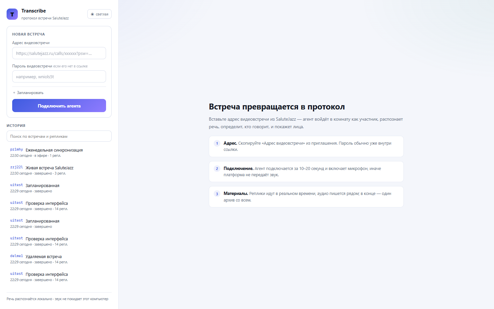
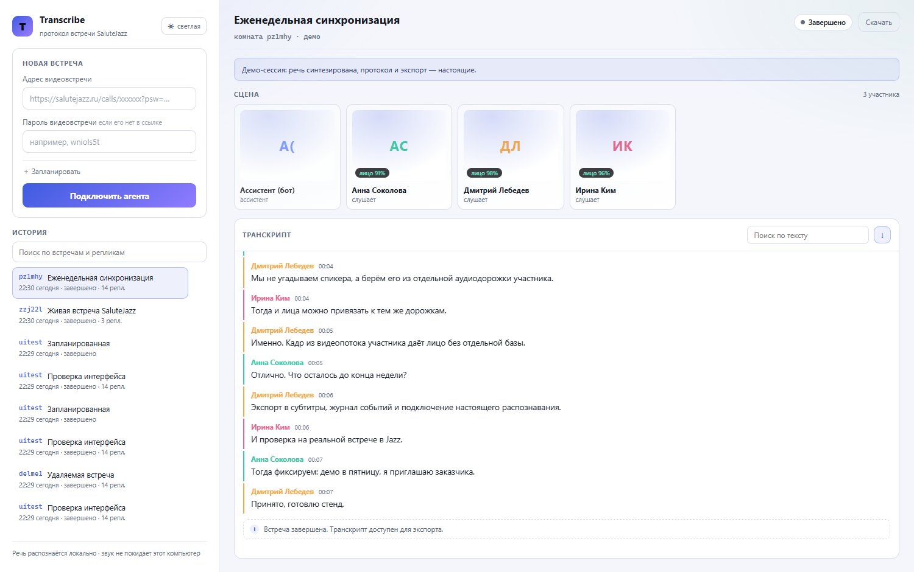
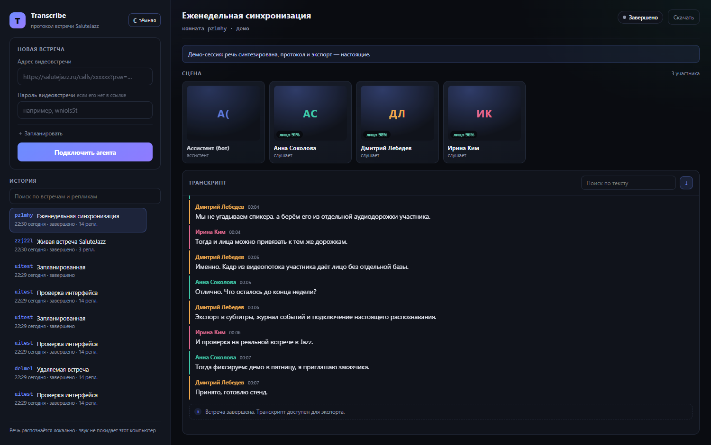
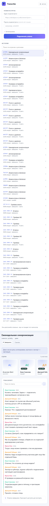

# Transcribe — онлайн-транскрибация встреч Jazz

Сервис, который подключает агента к видеовстрече по ссылке, распознаёт речь в реальном времени,
привязывает каждую реплику к участнику, показывает его лицо и складывает всё в файл.

Сейчас в репозитории работает **вертикальный срез целиком**: реальные REST/WS, реальный журнал
событий, реальные экспорты, реальный фронтенд. Синтезирована только речь — вместо Jazz и Whisper
работает `mock`-пайплайн, чтобы UI и протокол можно было отладить до того, как появится доступ к
встрече. Подмена одного пайплайна на настоящий не затрагивает остальной код.

| Готово | В работе |
|---|---|
| **Живая встреча SaluteJazz**: вход, по-дорожному аудио, запись, транскрипт | Метрики качества как гейт в CI (WER, задержка) |
| API, WebSocket-протокол событий, восстановление после рестарта | Идентификация по имени (InsightFace, Python 3.12) |
| Журнал событий JSONL как источник истины | Диаризация для микса (запись экрана, SIP) |
| Экспорт: SRT, VTT, Markdown, TXT, JSON, ZIP | Docker: конфигурация написана, сборка не проверена |
| Фронтенд: сцена, лента, поиск, темы, адаптив, история | |
| **Браузерный агент**: вход по ссылке, по-дорожному аудио, кадры участников | |
| **ASR**: faster-whisper + VAD, partial/final, GPU и CPU | |
| **Лица**: детекция YuNet, кроп в тайл, уверенность | |
| **Планировщик**: ссылка + время старта, отмена, переживает рестарт | |
| **Несколько спикеров одновременно**: общая модель, сериализованный инференс | |
| **Запись**: WAV по каждому участнику + архив «всё в ZIP» | |
| **История**: серверный поиск по репликам, удаление встречи с файлами | |
| **Интерфейс**: светлая/тёмная тема, адаптив до 420 px | |
| Тесты: 99 юнит/API + 2 сквозных «браузер → PCM → текст» | |
| **Приёмка** одной командой: `tools/acceptance.py` — 26/26, UI — 39/39 | |

Сценарий показа на собеседовании и ответы на неудобные вопросы — в [docs/DEMO.md](docs/DEMO.md).

### Что уже измерено на этой машине

| Метрика | Значение | Условия |
|---|---|---|
| WER на русском | **5.3 %** | large-v3-turbo, синтезированная речь 15 с |
| RTF (GPU) | **0.131** | RTX 3050 Laptop 4 ГБ, int8_float16 |
| RTF (CPU) | **0.615** | int8, тот же файл |
| Задержка финализации | **0.5–0.9 с** | 4-секундная фраза, GPU |
| Детекция лица | **5.3 мс** (320 px) / 18.2 мс (640 px) | YuNet, CPU |
| Сквозной тест | **31 с** | браузер + захват + Whisper + лицо на 15-секундной встрече |

Синтезированная речь — оптимистичная оценка (нет шума, эха и перекрытий), поэтому
на живой встрече WER будет выше; цифры нужны как точка отсчёта и как проверка, что
пайплайн не сломался.

## Как это выглядит

| Экран входа | Живая встреча |
|---|---|
|  |  |

| Светлая тема | Телефон (420 px) |
|---|---|
|  |  |

Скриншоты сняты с демо-сессии (`pipeline: "mock"`), поэтому имена и реплики — синтетические.

---

## Быстрый старт

```powershell
# 1. Зависимости бэкенда (Python 3.12+; mock-пайплайн работает и на 3.14)
python -m venv .venv
.\.venv\Scripts\python.exe -m pip install -r backend\requirements-dev.txt

# 2. Фронтенд
cd frontend
npm install
npm run build
cd ..

# 3. Запуск
.\scripts\dev.cmd
```

Откройте <http://127.0.0.1:8000>, вставьте ссылку вида `https://salutejazz.ru/<ссылка-из-приложения>`,
нажмите «Подключить агента». Через пару секунд появятся участники, лица и текст.
Документация API — <http://127.0.0.1:8000/docs>.

### После перезагрузки

Сервер — обычный процесс и сам не поднимается: после включения компьютера его нужно запустить
снова. Одна команда из корня репозитория:

```powershell
.\scripts\dev.cmd
```

`dev.cmd` — тонкая обёртка над `scripts\dev.ps1`, которая запускает PowerShell с
`-ExecutionPolicy Bypass`. Это важно: при политике `RemoteSigned`/`AllSigned` прямой вызов
`.\scripts\dev.ps1` может быть заблокирован («файл не имеет цифровой подписи»). Если политика
уже разрешает локальные скрипты, можно вызывать `.\scripts\dev.ps1` напрямую.

Полезные ключи:

```powershell
.\scripts\dev.cmd -Build       # пересобрать фронтенд и запустить
.\scripts\dev.cmd -Web         # плюс Vite с hot reload (http://127.0.0.1:5173)
.\scripts\dev.cmd -Port 8010   # другой порт
.\scripts\dev.cmd -Reload      # перезапуск при правках Python (дочерний процесс)
```

Ctrl+C останавливает сервер. Порт занят чужой копией — `Get-Process python | Stop-Process` или
`netstat -ano | findstr :8000`.

> **Почему не `uvicorn --reload`.** На Windows uvicorn с `--reload` ставит `SelectorEventLoop`,
> который не умеет запускать подпроцессы, а Playwright запускает свой драйвер именно так. Итог —
> `NotImplementedError` при подключении к встрече и «встреча завершена» в интерфейсе.
> Поэтому `-Reload` перезапускает дочерний процесс без этого флага: правки подхватываются,
> браузерный агент работает.

> **Важно про фронтенд.** Без `-Web` сервер отдаёт **последнюю собранную** версию из
> `frontend/dist`. Если правили React и не пересобрали — в браузере будет старая страница.
> Лечится `-Build` (или `-Web` для hot reload).

### Где смотреть логи

| Что | Где |
|---|---|
| Всё, что пишет сервис (с трассировками) | консоль запуска — в PyCharm это окно **Run** |
| То же в файле, с ротацией (5 МБ × 3) | `data/app.log` |
| Последние строки без доступа к файлу | <http://127.0.0.1:8000/api/logs?lines=300> |
| События одной встречи (JSONL) | `data/<id>/events.jsonl` или `/api/sessions/<id>/log` |
| Что было на экране при сбое входа | `data/<id>/agent-join-failed.png` |

Ошибка сессии теперь всегда содержит текст: пустые исключения вроде `NotImplementedError`
превращаются в `NotImplementedError (исключение без описания)`, а сбой запуска браузера —
в объяснение с подсказкой, что делать.

### Запуск из PyCharm

1. **Interpreter:** Settings → Project → Python Interpreter → Add → Existing → `.venv\Scripts\python.exe`.
2. **Run configuration** (Run → Edit Configurations → `+` → Python):
   - *Module name* (не Script path): `uvicorn`
   - *Parameters*: `app.main:app --host 127.0.0.1 --port 8000` — **без `--reload`**, иначе см. выше
   - *Working directory*: `<репозиторий>\backend`
   - *Environment variables*: `PYTHONUNBUFFERED=1`, при желании `HF_HOME=<репозиторий>\.models`
3. Готовая конфигурация лежит в `.run/api (uvicorn).run.xml` — PyCharm подхватывает её сам.
   Если он подсветил поле Module, выберите модуль проекта вручную.
4. Отладка: та же конфигурация через **Debug** (кнопка с жучком). Точки останова в `jazz.py`,
   `capture.py`, `asr.py` работают; стек и локальные переменные видны прямо в IDE.

PyCharm Professional умеет то же через шаблон **FastAPI**: укажите `backend/app/main.py`,
остальное он подставит сам. В Community используйте конфигурацию выше.

Для разработки фронтенда удобнее Vite с проксированием:

```powershell
cd frontend
npm run dev          # http://127.0.0.1:5173, /api и /events уходят на :8000
```

---

## Реальный режим: агент + локальный ASR

```powershell
.\.venv\Scripts\python.exe -m pip install -r backend\requirements-ml.txt
```

В интерфейсе вставьте **«Адрес видеовстречи»** из приглашения SaluteJazz и нажмите
«Подключить агента». Пароль обычно уже внутри ссылки (параметр `psw`); отдельное поле нужно только
для ссылки без пароля. Интерфейс работает только с живой встречей — сценарное демо осталось в API
(`"pipeline": "mock"`), чтобы экран продукта не выглядел тестовым стендом.

```powershell
curl -X POST http://127.0.0.1:8000/api/sessions -H "Content-Type: application/json" -d '{
  "meeting_url": "https://salutejazz.ru/<ссылка-из-приложения>",
  "pipeline": "jazz",
  "headless": true
}'
```

Что происходит по шагам:

1. Playwright открывает встречу в Chrome, заполняет «Ваше имя» (пароль берётся из ссылки или из
   поля в форме) и нажимает «Подключиться», затем включает микрофон — без этого платформа не
   передаёт звук.
2. До загрузки скриптов страницы ставится хук на `RTCPeerConnection`, поэтому агент видит
   каждую удалённую дорожку: отдельное аудио на участника и видео для кадров.
3. Аудио пересэмплируется в 16 кГц внутри браузера (`AudioContext({sampleRate: 16000})`) и
   уходит в Python пакетами по 100 мс — без ffmpeg и без временных файлов.
4. На каждый трек работает свой `ParticipantASR`: энергетический VAD режет речь на фразы,
   промежуточные гипотезы идут жадным декодированием, финал — beam search.
5. Первый кадр участника попадает в тайл. Пока детектор лиц не подключён, статус честно
   называется `frame` («кадр есть, лицо не распознано»), а не `detected`.

Модель (`large-v3-turbo`, ~1.6 ГБ) скачивается в `.models/` при первом запуске. Для GPU
достаточно колёс из `requirements-ml.txt`: ctranslate2 сам подхватит `cublas64_12.dll` и
`cudnn64_9.dll`, полный CUDA Toolkit не нужен.

### Встреча-двойник для проверки без Jazz

`tools/fake_meeting/index.html` — мини-встреча: участники говорят по настоящему
`RTCPeerConnection` внутри страницы, а звук берётся из WAV-файла.

```text
http://127.0.0.1:8000/fake-meeting/?peers=2&audio1=/fixtures/ru-1.wav&name1=Анна Соколова&audio2=/fixtures/ru-2.wav&name2=Дмитрий
```

Так проверяется весь путь, кроме самого Jazz. Если что-то не работает, начните с диагностики:

```powershell
.\.venv\Scripts\python.exe tools\debug_capture.py --seconds 15
```

Скрипт печатает дорожки, ошибки страницы, число аудиочанков и состояние хука.

### Ссылка и время

Агент умеет подключаться не сразу, а в назначенный момент — это требование ТЗ «указывается
ссылка, время».

- В интерфейсе — свёрнутый блок **«Запланировать»** внутри формы; пустое время означает «сейчас».
- В API — `start_at` в ISO 8601: `{"meeting_url": "...", "start_at": "2026-11-25T10:30:00+03:00", "pipeline": "jazz"}`.
- Пока сессия в состоянии `scheduled`, агент не запущен и ничего не пишет; отмена — тот же
  `POST /api/sessions/{id}/stop`.
- Запланированная сессия переживает перезапуск сервера: параметры лежат в `meta.json`, и
  планировщик взводит её заново.
- Таймкоды транскрипта начинаются с момента реального входа, а не с момента брони.

Прошедшее время в `start_at` отклоняется с 422 — типичная ошибка при работе с часовыми поясами.

---

## Как это устроено

```
┌──────────────┐   ссылка, старт    ┌────────────────────────────────────┐
│  React SPA   │ ─────────────────▶ │  FastAPI: REST + WebSocket         │
│  сцена/лента │ ◀───────────────── │  SessionManager → Session          │
└──────────────┘  события событий   │  события → JSONL + подписчики      │
                                    └───────────┬────────────────────────┘
                                                │  Pipeline
                          ┌─────────────────────▼───────────────────────┐
                          │  MockPipeline (сейчас)                      │
                          │  JazzPipeline (Playwright + ASR + лица)     │
                          └─────────────────────────────────────────────┘
```

Три идеи, на которых держится код:

1. **Пайплайн — единственное, что знает, откуда берётся звук.** Всё остальное работает с событиями.
   Поэтому mock и настоящий агент взаимозаменяемы, а тесты не зависят от сети.
2. **Журнал событий — источник истины.** Каждое событие сначала пишется в `data/<id>/events.jsonl`,
   потом рассылается в браузер. Экспорт и восстановление после рестарта читают журнал, а не память.
3. **Спикер берётся из дорожки, а не угадывается.** У каждого участника в браузере своя аудио- и
   видеодорожка, поэтому «кто говорит» — это метаданные, а не результат кластеризации. Слепая
   диаризация остаётся только страховкой для микса (SIP-подключение, запись экрана).

### Протокол

Каждое сообщение — один JSON-объект. Сервер → клиент: `hello`, `session`, `participant`, `speech`,
`segment`, `face`, `notice`, `done`, `ping`. Клиент только читает сокет; действия идут через REST,
поэтому любое изменение состояния имеет идемпотентную точку входа.

```
{"type":"segment","at_ms":8120,"segment":{"id":"p-anna-3","participant_id":"p-anna",
 "start_ms":7800,"end_ms":8120,"text":"Хорошо. Что с задержкой","final":false}}
```

`final: false` — промежуточная гипотеза (в UI серая, с мигающим курсором). `final: true` с тем же
`id` заменяет её.

### API

| Метод | Путь | Назначение |
|---|---|---|
| GET | `/api/health` | живость, доступные пайплайны, готовность статики |
| GET | `/api/sessions?q=` | история, новые сверху; `q` ищет по названию, ссылке, именам и репликам |
| POST | `/api/sessions` | запустить агента: `meeting_url`, `password?`, `title?`, `start_at?`, `pipeline?` |
| GET | `/api/sessions/{id}` | снимок: участники, сегменты и список записанных WAV |
| POST | `/api/sessions/{id}/stop` | остановить (идемпотентно) |
| DELETE | `/api/sessions/{id}` | остановить и удалить встречу вместе с записью и журналом |
| GET | `/api/sessions/{id}/audio/{file}` | скачать запись участника (WAV) |
| GET | `/api/sessions/{id}/export/{fmt}` | `srt` · `vtt` · `md` · `txt` · `json` · `zip` (всё разом) |
| GET | `/api/sessions/{id}/log` | журнал событий (JSONL) — аудит и отладка |
| WS | `/events/{id}` | поток событий |

Идентификаторы сессий проверяются регулярным выражением, а имена аудиофайлов — отдельно: путь
никогда не собирается из пользовательской строки, поэтому `../` в них не проходит.

---

## Кто в комнате: входы, выходы и тишина в микрофоне

Встреча меняется, пока идёт запись, и браузер — единственный источник правды.

- **Имена.** Список участников читается при входе и затем каждые 3 секунды. Трек, который
  пришёл раньше, чем отрисовалась плитка, получает настоящее имя, как только оно появилось —
  поэтому гость, подключившийся с телефона через минуту, не остаётся «Участником 2».
  Если продукт сам показывает гостя как «Участник 2» (человек не ввёл имя), агент честно
  оставляет то, что видит, и не выдумывает.
- **Выход.** Дорожка завершилась (`ended` или соединение закрылось) — участник помечается
  вышедшим сразу. Пропажа имени из списка считается выходом только после двух опросов подряд
  (≈6 секунд), чтобы перерисовка комнаты не выглядела как уход. Вышедший исчезает со сцены,
  но его реплики остаются в протоколе — они были.
- **Пустая комната.** Если людей не осталось, агент ждёт `TRANSCRIBE_EMPTY_ROOM_TIMEOUT`
  секунд (по умолчанию 60) и завершает встречу сам, а не остаётся висеть в комнате.
  Ноль отключает это поведение: тогда сессию закрывает кнопка «Остановить».
- **Микрофон.** Агент обязан быть с включённым микрофоном: пока все молчат, SFU не отдаёт
  чужие дорожки. Но Chrome с `--use-fake-device-for-media-stream` синтезирует писк, который
  остальные слышат как ударные. Поэтому агент публикует **тишину**: WAV на секунду, создаётся
  при старте в `.tmp` и передаётся браузеру через `--use-file-for-fake-audio-capture`.
- **Камера, включённая по ходу встречи.** Кадр ищется по идентификатору *аудио*дорожки, а не
  видео: видео-трек добавляется в тот же поток позже, когда человек включает камеру. Агент
  пробует пять раз за первые 40 секунд, поэтому «включил камеру через полминуты» всё равно
  даёт лицо в тайле. Если камеры так и не было — статус `без камеры`, без выдумок.
- **Обновления участника — патчи.** Переименование или уход отправляют только изменившиеся
  поля, а сессия их сливает. Раньше полный снимок затирал уже найденное лицо и миниатюру.
- **Дубликаты.** Один и тот же финальный текст от одного трека в пределах 2 секунд считается
  повторной выдачей декодера и отбрасывается — иначе «алло» задваивается.
- **Время в файлах.** Локальное, с офсетом (`25.11.2026 22:33 +0300`), а не UTC: протокол
  читают те, кто был на встрече.

## Запись, хранение и приватность

Пока агент слушает, он пишет **WAV отдельно по каждому участнику**: 16 кГц, моно, 16 бит — ровно
тот формат, который приходит из браузера и который ждёт Whisper, поэтому никакого перекодирования
нет. Файлы лежат в `data/<id>/audio/<участник>.wav`, а транскрипт ссылается на того же участника.

| Что | Где | Как ограничено |
|---|---|---|
| Аудио участника | `data/<id>/audio/p-1.wav` | 1 ГБ на сессию, дальше запись останавливается с предупреждением в логе |
| События | `data/<id>/events.jsonl` | источник истины для экспорта и восстановления |
| Архив | `GET /export/zip` | собирается во временный файл и удаляется после ответа |

- `TRANSCRIBE_RECORD=0` полностью выключает запись (например, на сервере без права хранить звук).
- Удаление встречи в интерфейсе (`DELETE /api/sessions/{id}`) стирает и запись, и журнал: каталог
  сверяется с корнем данных перед `rmtree`, поэтому выйти за его пределы невозможно.
- Всё обрабатывается локально: ни звук, ни текст никуда не отправляются. Но запись встречи — это
  персональные данные, поэтому в продакшне нужны согласие участников, срок хранения и права доступа;
  в MVP роль авторизации играет привязка к `127.0.0.1`.

## Интерфейс

- Светлая и тёмная темы: переключатель в шапке сайдбара, выбор сохраняется в `localStorage`, до
  первого кадра тема применяется инлайн-скриптом (без мигания), по умолчанию — системная.
- Адаптивность: три контрольных ширины в тестах (1024, 760, 420). На планшете сайдбар уже, на
  телефоне — одна колонка, сцена становится горизонтальной лентой тайлов, шапка залипает сверху.
- Поиск по истории ищет по названию, ссылке, именам участников и тексту реплик, показывает фрагмент
  совпадения и работает на сервере (`?q=`), а не фильтрацией уже загруженного списка.
- Удаление — в два шага (`✕` → «удалить»), с автоотменой через 4 секунды.
- «Скачать» в шапке: архив со всем, отдельные форматы, записи участников с длительностью и журнал.

---

## Подключение к SaluteJazz: что проверять и в каком порядке

Три пути, от надёжного к универсальному:

| Путь | Как | Плюсы | Минусы |
|---|---|---|---|
| **A. API/бот Jazz** | REST + вебхуки, запись и транскрипт из облака | стабильно, легально | нужно подтвердить, что бот-доступ вообще есть |
| **B. SIP/H.323** | Jazz звонит на ваш медиасервер, запись в реальном времени | не зависит от UI | обычно микс-аудио и участник без имени |
| **C. Браузерный агент** | Playwright входит по ссылке как гость, перехватывает дорожки | без API, есть по-дорожке аудио и видео, имена из DOM | хрупко: лобби, SSO, антибот, обновления UI |

Путь выбирается **после 45-минутного спайка**, а не до него:

> **Продукт переименован.** «Джазз от Сбера» теперь **SaluteJazz** на `salutejazz.ru`;
> старый `jazz.sber.ru` отдаёт 308-редирект туда же. Документация —
> <https://developers.sber.ru/portal/products/jazz-by-sber>.

### Что выяснено про вход в SaluteJazz (проверено на живой комнате)

1. **Ссылка-приглашение с `?psw=` — это deep link для приложения.** Веб-клиент на такой ссылке
   пишет «Ваш браузер не поддерживается» и пытается открыть `jazz://join`. Та же комната без
   параметра — `https://salutejazz.ru/calls/<id>` — открывает нормальное веб-лобби с полями
   «Ваше имя» и «Пароль видеовстречи». `spike/probe_jazz.py` теперь сам срезает `psw` и
   предупреждает об этом.
2. **Анонимная встреча живёт, пока в ней создатель.** Если он закрыл вкладку, комната завершается,
   и вход по ссылке перебрасывает на главную с сообщением «Встреча завершена». Для проверки агента
   создатель должен оставаться в комнате (или нужен аккаунт Sber ID).
3. **С 27.11.2026 анонимные встречи отключаются** — на главной висит объявление: создание и
   подключение ко встречам анонимных пользователей станут невозможны. Если демо позже этой даты,
   нужен Sber ID.
4. Браузерный чекер клиента обходится его же флагом
   `sessionStorage['s2b.browserChecker.skipChecking']='true'` плюс запуском с
   `ignore_default_args=["--enable-automation"]`. В логах он видит `HeadlessChrome` и уходит в
   схему «открыть в приложении»; с этими двумя настройками показывается лобби.

Проверка на реальной встрече:

```powershell
# комната должна быть активна, создатель — внутри
.\.venv\Scripts\python.exe spike\probe_jazz.py `
    --url "https://salutejazz.ru/calls/xxxxxx" --password "<пароль>" --channel chrome --seconds 45
```

### Проверено на живой встрече SaluteJazz

Пайплайн `jazz` подключён к настоящей комнате и выдал транскрипт с привязкой к участнику:

```
participant: Тестовый хост (human)
[810-4410]     p-1: Сегодня обсуждаем транскрибацию встреч в Джесс.
[5070-11310]   p-1: Дмитрий подготовил демонстрацию, а Ирина соберёт обратную связь от заказчика.
[12060-14850]  p-1: Коллеги, начинаем планёрку.
```

Что выяснилось на живом продукте (всё это уже учтено в коде):

1. **Chrome, не Edge.** В Edge веб-клиент показывает «Ваш браузер не поддерживается» и уводит в
   приложение, а с `channel="chrome"` открывается обычное лобби. Поэтому `JazzPipeline` по
   умолчанию запускает Chrome.
2. **Нужно снять `--enable-automation`** (Playwright добавляет его сам) и заранее выставить
   `sessionStorage['s2b.browserChecker.skipChecking']='true'`. Без этого лобби не появится.
3. **Микрофон должен быть включён хотя бы у кого-то**, иначе SFU не поднимает соединение и дорожек
   нет вовсе. Агент включает свой после входа.
4. **Имена участников** берутся из `aria-label` плиток (`participantItem-*`) и подставляются в
   дорожку, даже если аудио пришло раньше, чем отрисовался список.
5. Аудиодорожка приходит как `remote audio`, по одной на участника — привязка спикера остаётся
   метаданными, без диаризации.

Автономная проверка без ручных действий (создаёт комнату, «говорит» синтезированной речью,
подключает продукт через API и печатает транскрипт):

```powershell
.\.venv\Scripts\python.exe tools\live_e2e.py --seconds 150
```

```powershell
# Первый прогон — с браузером на экране, чтобы увидеть, требует ли встреча логина
.\.venv\Scripts\python.exe spike\probe_jazz.py --url "https://salutejazz.ru/<ссылка-из-приложения>" --headed --seconds 45
```

Скрипт подменяет `RTCPeerConnection` до загрузки страницы, поэтому видит все удалённые дорожки,
пишет по одному `.webm` на аудиодорожку и выдаёт вердикт:

```json
{"per_participant_audio": true, "audio_track_count": 3, "video_tiles": 4,
 "largest_tile": {"w": 640, "h": 360}, "media_recorder": true,
 "next_step": "per-track pipeline (path C): ASR per participant, speaker from the track"}
```

`per_participant_audio: true` — работаем по пути C и получаем спикеров бесплатно.
`audio_track_count: 1` — звук приходит миксом, включаем диаризацию (pyannote на CPU).
Артефакты прогона (`spike/out/<дата>/`) стоит сохранить: это доказательство для интервью.

---

## Что считать качеством

| Метрика | Цель MVP | Как мерить |
|---|---|---|
| Задержка «конец фразы → финальный текст», p95 | ≤ 2.5 с | лог `events.jsonl`: `at_ms` сегмента минус `end_ms` |
| WER на русском | ≤ 20 % | 3 записи по 3–5 минут с эталонной расшифровкой |
| Точность «кто говорил» | ≥ 95 % | по дорожкам — почти 100 %, микс — по разметке |
| Детекция лиц | ≥ 90 % кадров | доля кадров тайла с `face_status=detected` |

Задержку и WER надо записать в README первыми — вопрос «а насколько точно и быстро?» будет задан
в первые две минуты демо.

---

## Тесты и проверки

```powershell
# API: полный жизненный цикл, экспорты, журнал, WebSocket, идемпотентность
cd backend; ..\.venv\Scripts\python.exe -m pytest tests -q

# VAD и сегментация: синтетическое аудио, без модели и браузера
cd backend; ..\.venv\Scripts\python.exe -m pytest tests\test_asr_detector.py -q

# Участники и запись: имена, выходы, тишина в микрофоне, WAV, поиск, ZIP (99 тестов всего)
cd backend; ..\.venv\Scripts\python.exe -m pytest tests\test_capture_participants.py -q

# Сквозной тест: браузер → дорожки → PCM → VAD → Whisper → протокол.
# Нужны браузер, скачанная модель и сгенерированный WAV (см. шапку файла теста).
$env:TRANSCRIBE_E2E = "1"
cd backend; ..\.venv\Scripts\python.exe -m pytest tests\test_capture_e2e.py -q

# Дым против живого сервера
.\.venv\Scripts\python.exe tools\smoke.py http://127.0.0.1:8000 8

# Верстка и поведение: 39 проверок — темы, ширины 1024/760/420, типографика, поиск, удаление
.\.venv\Scripts\python.exe tools\ui_check.py http://127.0.0.1:8000

# Скриншоты для README и разбора полёта (нужен установленный Edge/Chrome)
.\.venv\Scripts\python.exe tools\shot.py http://127.0.0.1:8000
```

Проверки верстки специально сделаны измерениями DOM, а не скриншотами: скриншот без сравнения
ничего не гарантирует, а `scrollWidth > innerWidth` ловит регрессию сразу.

### Приёмка по пунктам ТЗ

Одна команда проходит по требованиям и печатает таблицу: ссылка, участники, лица, привязка
реплик, все экспорты, журнал, WebSocket, время старта и (с `--full`) живой браузерный агент.

```powershell
# быстрый прогон: API, UI, mock, экспорты, планировщик, WebSocket
.\.venv\Scripts\python.exe tools\acceptance.py --base http://127.0.0.1:8000

# полный: плюс агент на встрече-двойнике, живой текст и детекция лица
.\.venv\Scripts\python.exe tools\acceptance.py --base http://127.0.0.1:8000 --full
```

Текущий результат на этой машине: **26/26** (отчёт пишется в `.artifacts/acceptance-*.json`).
Реальный Jazz этим не покрывается — для него отдельный инструмент, `spike/probe_jazz.py`.

Метрики качества — отдельным инструментом, на синтезированной речи через системный голос
(эталон известен посимвольно):

```powershell
powershell -NoProfile -ExecutionPolicy Bypass -File tools\make_speech.ps1 `
    -Text "Коллеги, начинаем планёрку." -Out .artifacts\speech\ru-1.wav
.\.venv\Scripts\python.exe tools\asr_bench.py --wav .artifacts\speech\ru-1.wav `
    --text "Коллеги, начинаем планёрку." --model large-v3-turbo --device cuda
```

---

### Про присутствие и имена

- Браузер не отдаёт «кто говорит» для дорожки: имя берётся из плитки участника, поэтому при
  двух людях с одинаковым отображаемым именем привязка может перепутаться. Для MVP это
  приемлемо, полноценное решение — SIP-запись или API с идентификаторами.
- Выход определяется по завершению дорожки и по исчезновению имени из списка. Если продукт
  держит плитку «призраком» после ухода, агент узнает об этом позже (или по закрытию комнаты).
- Агент остаётся в комнате, пока сессию не остановят или пока комната не опустеет; это
  осознанно: человек может вернуться, и встреча не должна обрываться на переподключении.

## Ограничения и риски (честно)

- **Юридика.** Запись встреч и обработка биометрии — особая категория персональных данных по
  152-ФЗ. В MVP лица не идентифицируются по базе: лицо привязывается к имени участника из самой
  встречи. Для продакшна нужны согласие, уведомление участников о записи и хранение только внутри
  контура.
- **Хрупкость браузерного агента.** Лобби, SSO, капча и редизайн UI Jazz ломают вход. Это причина
  держать путь A/B в плане, а не откладывать на потом.
- **Ресурсы.** На 4 ГБ VRAM ASR и диаризация одновременно не живут: ASR на GPU, лица и диаризация
  на CPU или последовательно.
- **Перекрывающаяся речь.** По дорожкам решается тривиально, на миксе — нет.
- **Лица: детекция ≠ идентификация.** YuNet отвечает «в кадре есть лицо» и даёт кроп с
  уверенностью. Он не отвечает «это Иван Петров»: для этого нужны эмбеддинги (InsightFace,
  ArcFace) и база лиц, а это уже биометрия со всеми требованиями 152-ФЗ. Привязка «лицо →
  реплика» и так берётся из дорожки, поэтому для задачи идентификация не нужна.
- **Python 3.14.** faster-whisper и OpenCV здесь работают (есть колёса cp314), поэтому весь MVP
  живёт на одном интерпретаторе. Второй venv с Python 3.12 понадобится только для InsightFace,
  если появится требование узнавать людей по имени.
- **Шум и эхо.** Энергетический VAD не отличает речь от музыки и щелчков; на живой встрече его
  стоит заменить на Silero VAD (нужен torch, то есть Python 3.12).

---

## Дорожная карта

| Шаг | Что делаем | Критерий готовности |
|---|---|---|
| 1 | Спайк Jazz (`spike/probe_jazz.py`) | известно, есть ли бот-API и по-дорожному аудио |
| 2 | `JazzPipeline`: вход по ссылке, дорожки в PCM, кадры участников | **сделано, проверено на встрече-двойнике** |
| 3 | ASR: VAD + faster-whisper по дорожкам, partial/final | **сделано: WER 5.3 %, RTF 0.13** |
| 4 | Лица: детекция YuNet, привязка к дорожке, кроп в тайл | **сделано: 5.3 мс/кадр, есть в e2e** |
| 5 | Микс-ветка: диаризация pyannote/эмбеддинги | работает на записи экрана и SIP |
| 6 | Docker Compose, метрики в CI, демо-видео | один `docker compose up` |

---

## Структура

```
backend/app/
  main.py        REST + WebSocket + раздача статики
  session.py     состояние сессии, планировщик, поиск, удаление, JSONL
  protocol.py    формат событий и участников (контракт для всех слоёв)
  capture.py     браузерный агент: вход, хук RTCPeerConnection, PCM и кадры
  asr.py         VAD, сегментация, faster-whisper (GPU/CPU), общая модель
  jazz.py        пайплайн: агент → ASR по дорожкам → события + запись
  recording.py   WAV по участникам, лимит размера, манифест
  bundle.py      архив «всё в ZIP» с манифестом и аудио
  faces.py       детектор лиц: YuNet (OpenCV), InsightFace — для идентификации
  mock.py        сценарный пайплайн для разработки и демо
  export.py      SRT / VTT / Markdown / TXT / JSON
backend/tests/   pytest: API, планировщик, VAD, конкурентность, лица,
                 запись, поиск/удаление/архив, сквозные тесты
frontend/src/    React + TS: сцена, лента, поиск, тема, история, экспорт
docs/DEMO.md     сценарий демонстрации и ответы на вопросы
spike/           probe_jazz.py — проверка реальной встречи
tools/           smoke, ui_check, shot, sitecustomize для песочницы
```

## Заметки по окружению

В этой машине сборка шла под песочницей Windows, отсюда два обходных пути (на обычной машине они
не нужны и безвредны):

- `tools/sandbox_sitecustomize.py` кладётся в `.venv/Lib/site-packages/sitecustomize.py` —
  без него `pip` падает на `tempfile.mkdtemp` (Windows-дескриптор `mode=0o700` и restricted token).
- `npm install`/`npm run build` и Playwright требуют полных прав: esbuild и драйвер Playwright
  запускают дочерние процессы с перехватом вывода, что песочница запрещает.

### Docker

```powershell
docker compose up --build            # UI + API + mock-пайплайн
docker compose build --build-arg INSTALL_BROWSER=1   # + браузер для живого агента
```

`Dockerfile` двухступенчатый: Node собирает фронтенд, Python 3.12 (ML-стек не живёт на 3.14)
запускает API. Модель лиц кладётся в образ, веса Whisper скачиваются в том `/models` при первом
запуске, встречи — в `/data`.

**Честно: на этой машине Docker не проверен** — Docker Desktop не запущен, демон недоступен.
Конфигурация написана по обычным практикам, но `docker compose up` нужно один раз прогнать у себя
перед демонстрацией; нативный запуск через `scripts/dev.ps1` проверен и является основным путём.

## Лицензия и CI

MIT — см. [LICENSE](LICENSE).

`.github/workflows/ci.yml` на каждый push и pull request прогоняет тесты бэкенда (Python 3.12),
статический анализ (`ruff check backend tools scripts`) и сборку фронтенда (Node 22).
Тесты лиц пропускаются без файла модели, а сквозной тест с браузером
включается только переменной `TRANSCRIBE_E2E=1` — поэтому CI не требует ни GPU, ни Chromium.

Формат сообщений коммитов, типы и области описаны в [CONTRIBUTING.md](CONTRIBUTING.md); там же —
хук `.githooks/commit-msg`, который не даёт отступить от формата.